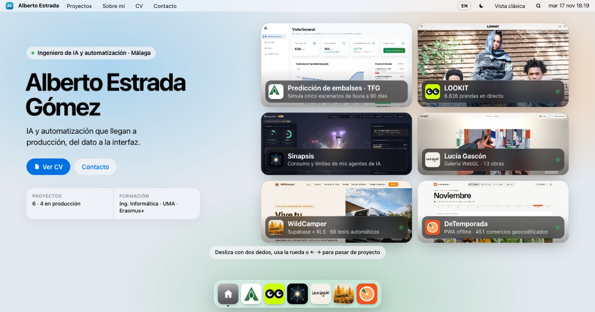

# Alberto Estrada Gómez · Portfolio

**https://albertoesgo.github.io/portfolio/** · [Vista clásica](https://albertoesgo.github.io/portfolio/clasica.html) · [English](https://albertoesgo.github.io/portfolio/classic.html)



Mi portfolio como sistema operativo: un escritorio tipo Mac en pantallas grandes y una interfaz tipo iOS en el móvil, donde cada proyecto es una ventana y un gesto lleva al siguiente.
Debajo hay una vista clásica, de una sola página, para buscadores, lectores de pantalla y quien prefiera leer.

> *My portfolio as an operating system: a Mac-style desktop on large screens and an iOS-style interface on phones. Bilingual (ES/EN), light and dark themes, plus a classic one-page view.*

## Decisiones

- **Sin framework ni dependencias.** HTML, CSS y JavaScript con módulos nativos. Carga rápida y nada que actualizar.
- **Una sola fuente de contenido.** Proyectos, casos de estudio y experiencia viven en `js/data.js`, en español e inglés. De ahí salen el escritorio y la vista clásica.
- **Cifras reales.** Las de LOOKIT se leen de su API en cada build; el build falla si el enlace de un proyecto deja de responder, así que nada sale «En producción» sin estarlo.
- **Datos de verdad en el TFG.** Los gráficos del simulador usan las trayectorias que generó el propio modelo (GCN-LSTM), no datos de ejemplo.
- **Accesible.** Navegación con teclado, foco visible, `prefers-reduced-motion`, contraste AA y la vista clásica como alternativa sin JavaScript.

## Cómo se usa

| Gesto | Acción |
|---|---|
| Deslizar, dos dedos en el trackpad, rueda o ← → | Proyecto anterior o siguiente |
| Pellizcar o ↑ | Vista general con filtros |
| ⌘K | Buscar por proyecto o tecnología |

Enlaces directos: `#aqua`, `#lookit`, `#sinapsis`, `#lucia`, `#wild`, `#detemp`. Idioma con `?lang=en`.

## Estructura

```
index.html          escritorio (monta js/os.js)
clasica.html        vista clásica en español  ┐ generadas por scripts/build.mjs
classic.html        vista clásica en inglés   ┘
js/data.js          contenido (ES/EN)
js/i18n.js          textos de la interfaz (ES/EN)
js/os.js            escritorio: ventanas, gestos, Dock, Spotlight, hojas
js/aqua.js          gráficos del TFG (SVG) a partir de data/aqua.json
css/                estilos del escritorio y de la vista clásica
img/shots/          capturas reales de cada proyecto (WebP) y vídeos (MP4)
scripts/build.mjs   CV, datos en vivo, comprobación de enlaces y vista clásica
tests/              coherencia del contenido (node --test)
```

## Desarrollo

Requiere Node 18 o posterior; no hay que instalar nada.

```bash
npm run dev      # compila y sirve en http://localhost:4321
npm test         # contenido completo en ES y EN, capturas, vídeos, enlaces y estados
```

`npm run build` copia el CV público, actualiza `data/live.json`, comprueba los enlaces, genera la vista clásica y versiona CSS y JS con un hash del contenido. El CV se genera aparte, en un repositorio privado; aquí solo se publica la versión sin teléfono.

Se publica con GitHub Pages desde `main`. La imagen para compartir (`og.jpg`, 1200 × 630) es una captura de `index.html?og`. Las capturas de Sinapsis son de su modo demostración, nunca con datos reales.

---

© Alberto Estrada Gómez. Los textos, las capturas y los logos de los proyectos no se pueden reutilizar.
